# Liquido — Arquitetura

Resumo de como a aplicação está organizada hoje. Para o "porquê" de cada decisão, veja o design em `docs/superpowers/specs/2026-11-19-comparador-renda-fixa-design.md`; para o histórico de tarefas, `docs/superpowers/plans/2026-11-19-comparador-renda-fixa.md`.

---

## 1. Visão geral

O Liquido é uma ferramenta pessoal (um usuário, sem login) que compara produtos de renda fixa brasileiros pelo **valor líquido na data de resgate informada**. Tudo roda num único processo no seu servidor, sem Docker.

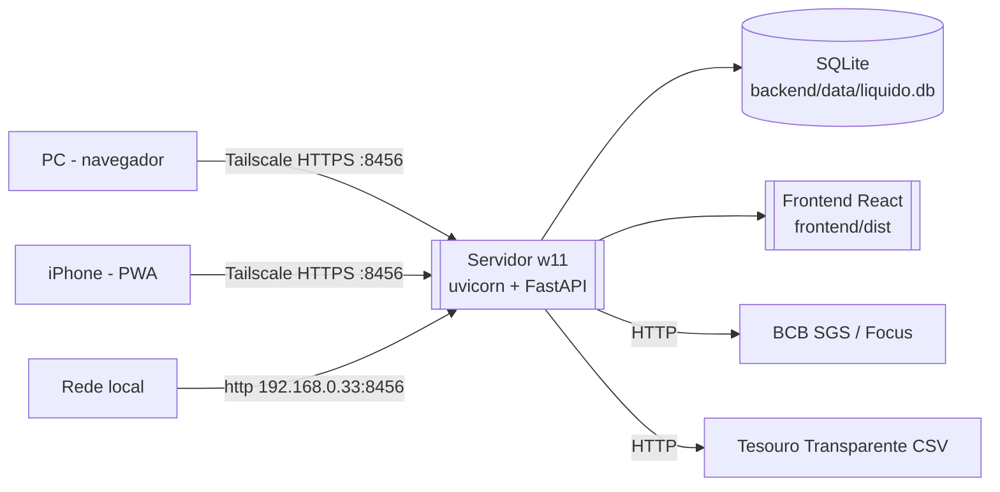

---

## 2. Estrutura de pastas

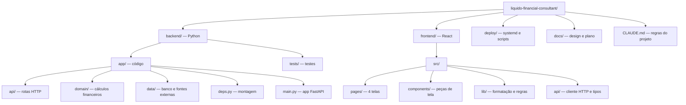

---

## 3. Backend

### 3.1 Camadas

O backend é dividido em três camadas com dependências em um só sentido: a API usa o domínio e os dados; o domínio não conhece HTTP nem banco.

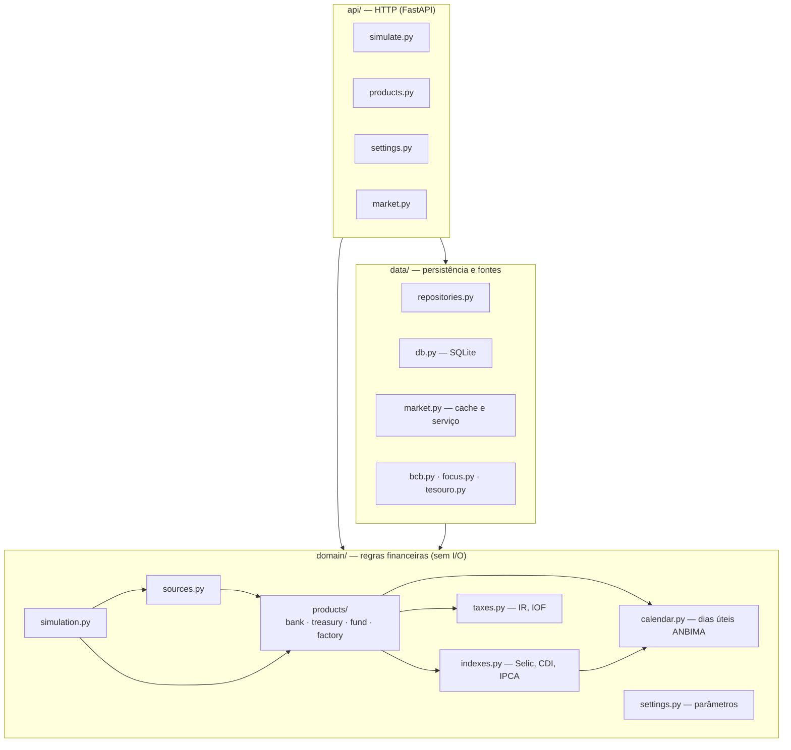

### 3.2 Rotas da API

Todas ficam sob `/api`. Valores monetários e taxas trafegam como **string** (ex.: `"71840.12"`, taxa `"0.1375"`).

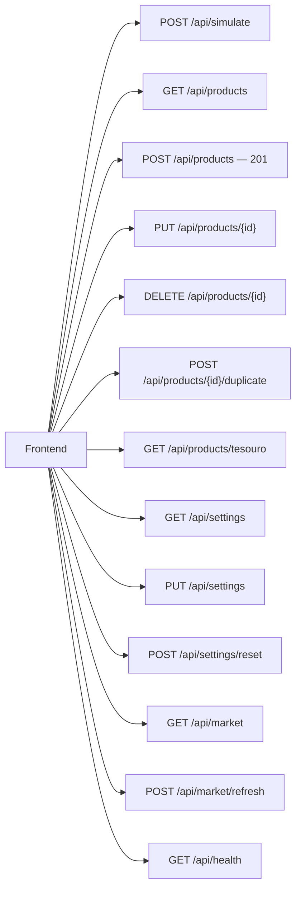

Erros de validação voltam com `422` e `{"detail": ["campo: mensagem", ...]}` em português. Rotas inexistentes em `/api` voltam como JSON `404`.

### 3.3 Fluxo de uma simulação

Este é o caminho que roda toda vez que você muda o valor ou a data.

```mermaid
sequenceDiagram
    autonumber
    participant UI as Comparador (React)
    participant API as POST /api/simulate
    participant V as Validação
    participant M as Mercado (cache)
    participant S as simulate_all
    participant P as Produto (CDB, LCI, Tesouro, Fundo…)

    UI->>API: {valor, data_alvo}
    API->>V: valor > 0 e data_alvo > hoje?
    alt inválido
        V-->>UI: 422 em português
    else válido
        API->>M: snapshot (Selic, CDI, IPCA, Tesouro)
        M-->>API: snapshot (cache de 6 h; falha mantém o último)
        API->>S: produtos ativos + contexto
        loop cada produto
            S->>P: simulate(valor, data_alvo)
            P-->>S: resultado (seção, líquido, alertas, série)
        end
        S-->>API: três listas ordenadas
        API-->>UI: vence_ate_data · vence_depois · indisponiveis · mercado
    end
```

### 3.4 Seções do resultado

Cada produto cai em uma das três seções, conforme a data de vencimento em relação à sua data de resgate:

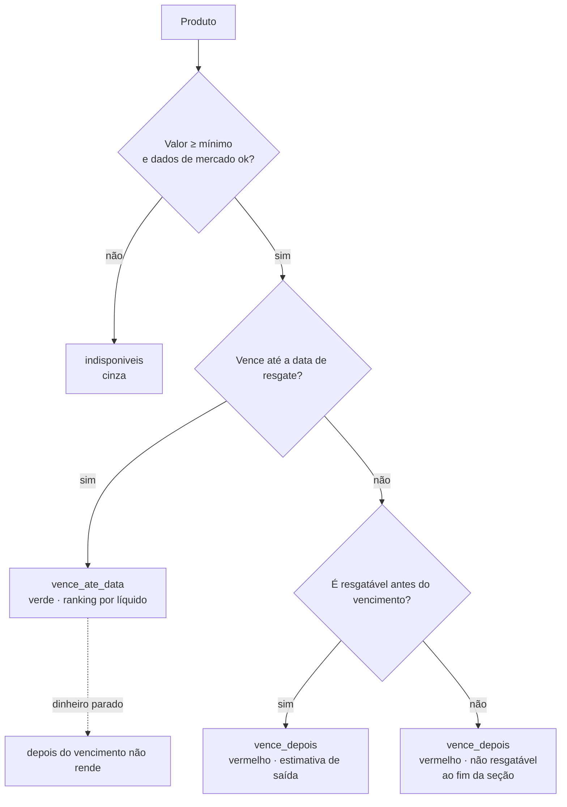

### 3.5 Tipos de produto

Uma classe base (`Product`) define a interface `simulate()`. Cada tipo implementa as regras próprias.

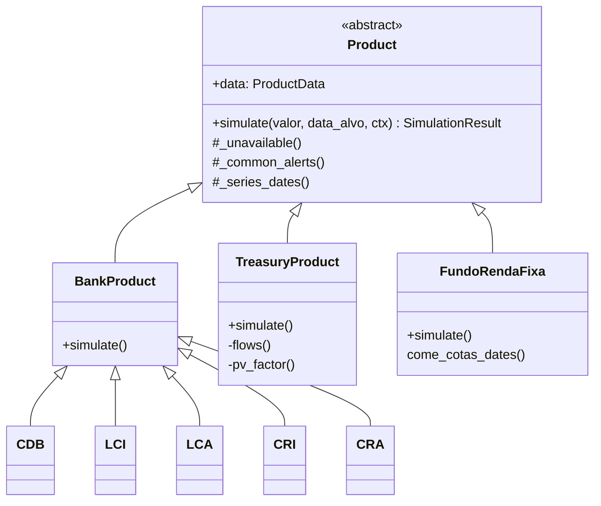

A fábrica `build_product()` escolhe a classe pelo campo `tipo`. Títulos do Tesouro vêm de `TesouroSource`; produtos cadastrados à mão vêm de `ManualSource`.

### 3.6 Motor de cálculo

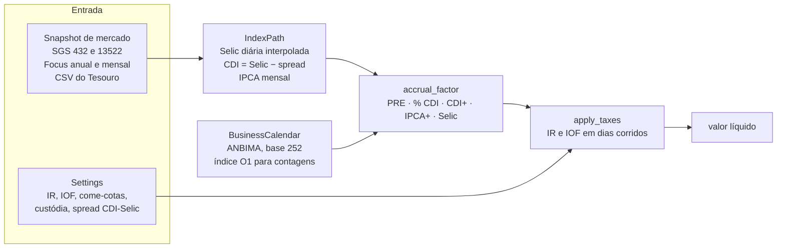

Regras que valem em todo o cálculo:
- **Decimal em todo lugar.** Nenhum `float` nos cálculos.
- **Dias úteis** (base 252) para juros; **dias corridos** para IR e IOF.
- **Taxas como fração**: `0.1375` = 13,75%.
- **Projeção sempre sinalizada**: produto que depende de Selic, CDI ou IPCA recebe o alerta `PROJECAO`.

### 3.7 Dados externos e cache

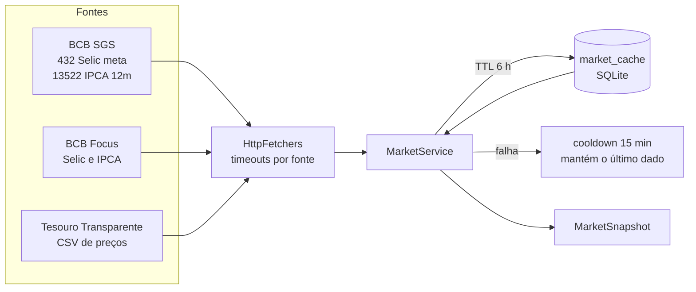

Se uma fonte falhar, o sistema continua com o último dado salvo e mostra o aviso com a data. Testes nunca acessam a rede: usam fixtures em `backend/tests/fixtures/market/`.

### 3.8 Banco de dados

SQLite, em um arquivo só: `backend/data/liquido.db`.

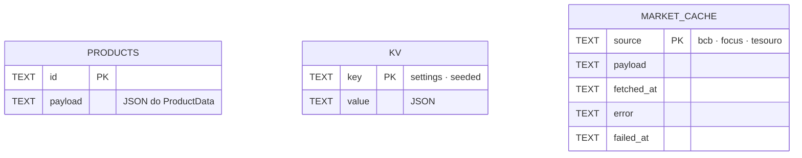

Na primeira execução, `seed/products_example.json` cria os 13 produtos fictícios (marcados como `exemplo`).

### 3.9 Concorrência

Uma única conexão SQLite é compartilhada, protegida por um lock (`Container` em `deps.py`). Há um segundo lock só para a atualização do mercado, para que duas atualizações não rodem ao mesmo tempo. Nenhuma chamada de rede acontece dentro do lock do banco.

---

## 4. Frontend

### 4.1 Telas e componentes

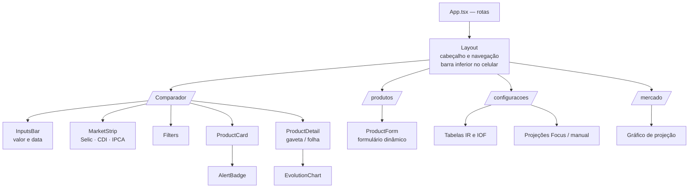

### 4.2 Camadas do frontend

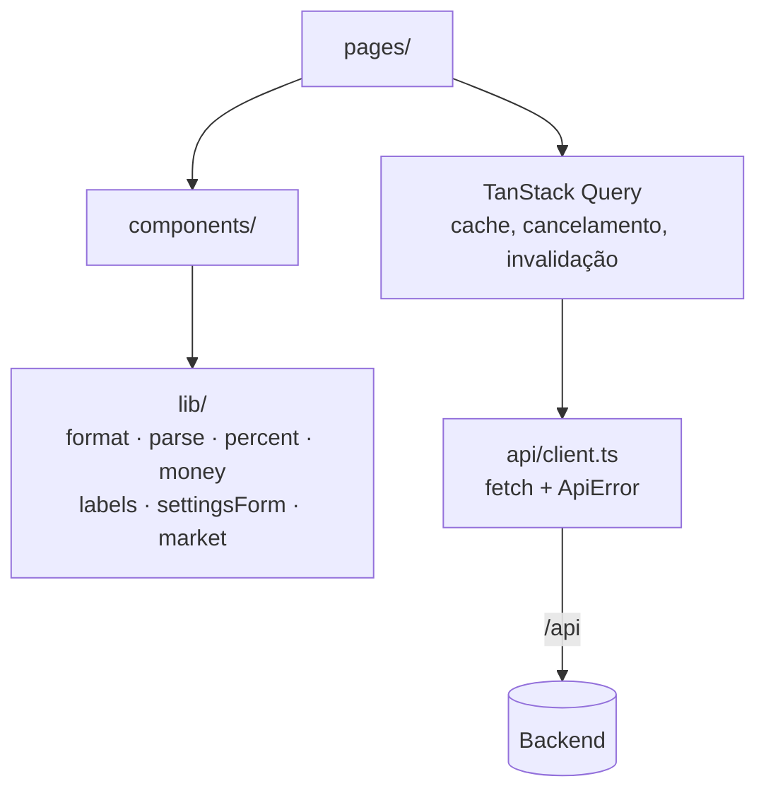

- **`lib/percent.ts` e `lib/money.ts`** fazem a conversão de % e de dinheiro com strings exatas, sem `float`.
- **`lib/format.ts`** só formata para exibição (pt-BR).
- **`api/client.ts`** guarda o `AbortSignal` das consultas, então uma simulação antiga é cancelada quando você digita de novo.

### 4.3 Como o Comparador reage a você

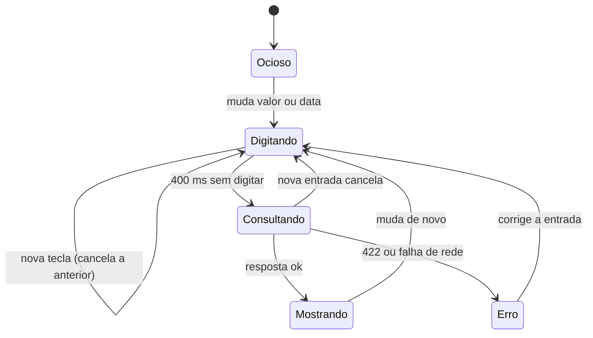

Com entrada inválida, as seções de resultado somem e aparece só a mensagem de validação.

### 4.4 Instalável (PWA)

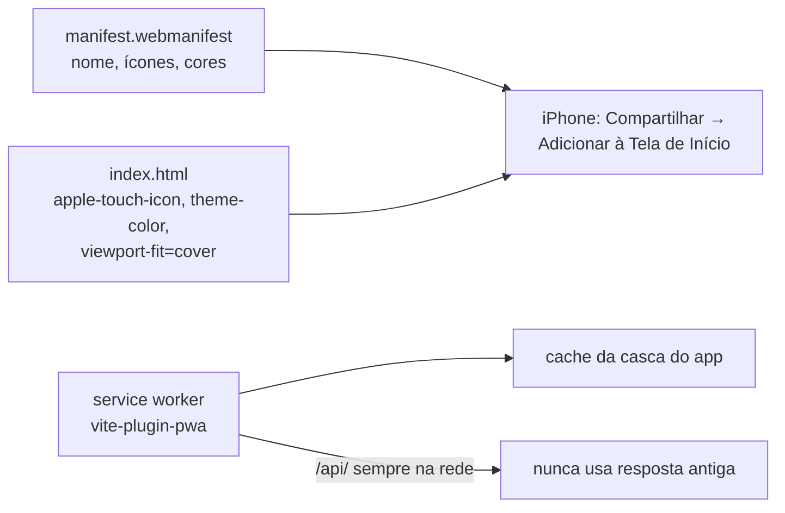

---

## 5. Entrega no servidor

### 5.1 Processo e portas

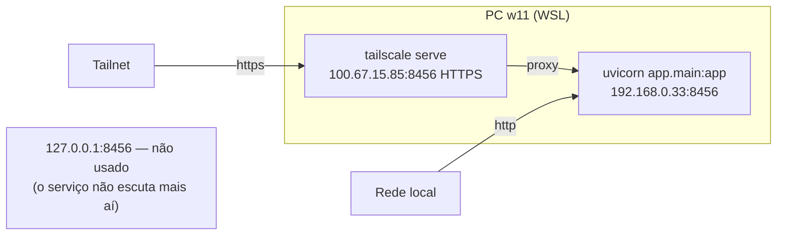

Antes de publicar, o `install.sh` confere se a porta já está ocupada e não sobrescreve um `tailscale serve` de outro serviço na porta 443.

### 5.2 Serviço e scripts

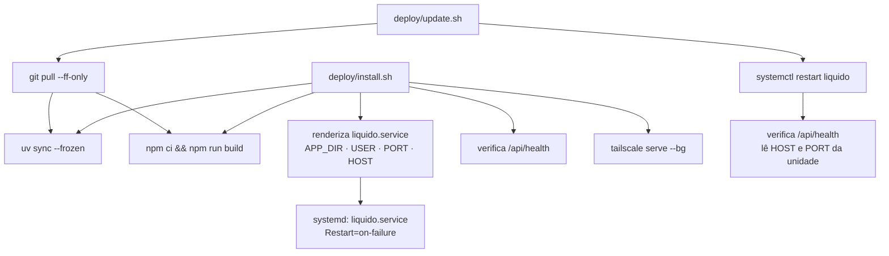

### 5.3 Como o FastAPI serve o frontend

Uma única aplicação atende tudo. `main.py` monta as rotas `/api` e, para o resto, devolve os arquivos de `frontend/dist`.

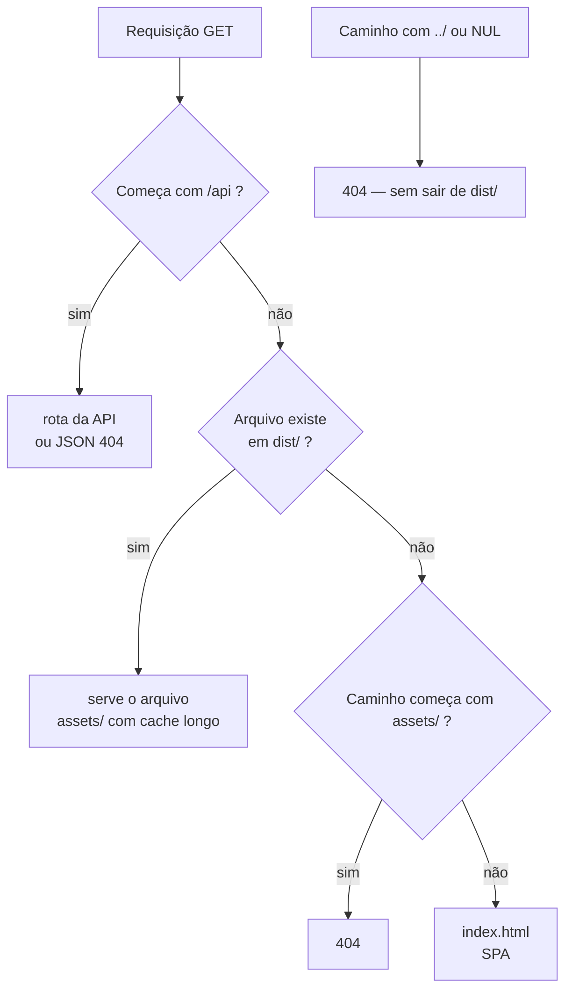

Cabeçalhos: `index.html` e `sw.js` com `no-cache`; `assets/*` com cache imutável.

---

## 6. Testes

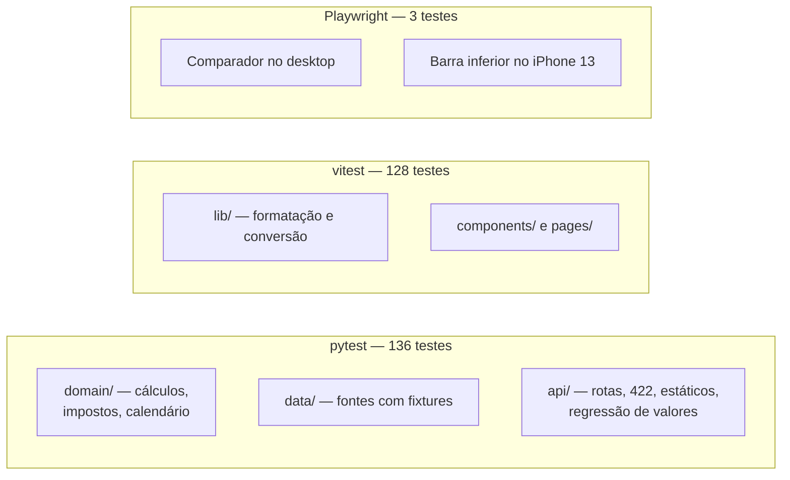

O teste de regressão (`test_simulate_regression.py`) compara valores de referência com tolerância de 1e-12. Se algum cálculo mudar sem querer, ele falha.

---

## 7. Regras do projeto (resumo do CLAUDE.md)

1. `Decimal` nos cálculos; arredondar só na apresentação.
2. Taxas como fração no domínio; `%` só nas bordas.
3. Dias úteis ANBIMA (base 252) para juros; dias corridos para IR e IOF.
4. Decimal trafega como string na API.
5. Alíquotas e custos vêm de `Settings`, nunca de constantes espalhadas.
6. Testes sem rede.
7. TDD: teste primeiro, vê-lo falhar, depois implementar.
8. Projeção e estimativa de mercado sempre sinalizadas.

---

## 8. Limitações conhecidas

- Ofertas de bancos (XP, BTG, etc.) são cadastradas à mão ou importadas; não há busca automática.
- Projeções são estimativas.
- Simulação do Tesouro leva alguns segundos com muitos títulos (otimizada, mas ainda a parte mais pesada).
- Renda+ e Educa+ usam modelo simplificado.
- Sem login: a proteção é a rede Tailscale e a rede local.
- Bind em `192.168.0.33` depende do WSL estar em modo espelhado ou com redirecionamento de porta.
